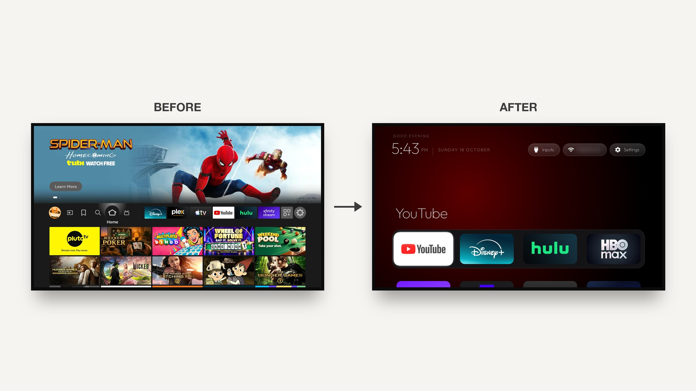
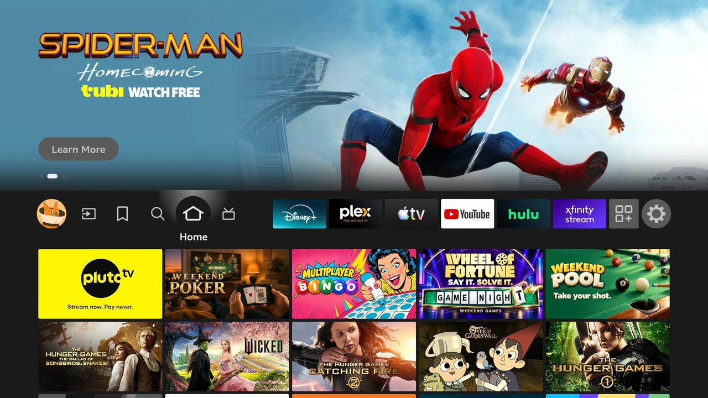
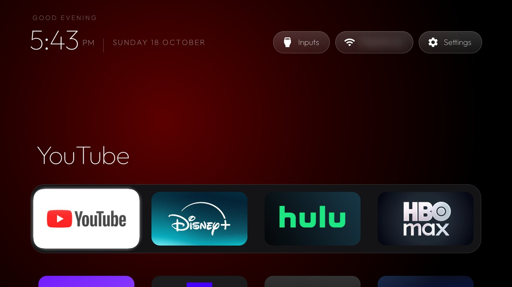

# tv-vibehack

> **Fire TV branch (`firetv`)**: adapted for the Insignia NS-55F301NA22. Use [PROMPT-FIRETV.md](PROMPT-FIRETV.md). The stock Fire launcher must stay enabled; install the launcher with `FIRE_TV=1 launcher/build-and-install.sh`.

**Your TV, minus the ads.**

Strip the bloatware from any Android TV or Google TV over Wi-Fi, and replace the ad-filled home
screen with a clean launcher that looks like an Apple TV. No root, no cable, nothing uninstalled,
and a one-line restore if you change your mind.



It started as an afternoon fixing my parents' Mi TV, which showed them an advert before they
could reach Netflix. The whole thing was done with Claude Code talking to the real TV, and the
prompt that did it is in this repo so you can do the same with yours.

---

## Table of contents

- [How it works](#how-it-works)
- [Quick start](#quick-start)
- [What you get](#what-you-get)
- [Supported TVs](#supported-tvs)
- [Doing it by hand](#doing-it-by-hand)
- [The launcher](#the-launcher)
- [Fire TV (Insignia NS-55F301NA22)](#fire-tv-insignia-ns-55f301na22)
- [Troubleshooting](#troubleshooting)
- [Questions people ask](#questions-people-ask)
- [Contributing](#contributing)
- [Licence](#licence)

---

## How it works

Android TVs have the same debug bridge as Android phones. Once you switch on USB debugging in the
TV's developer options, the TV listens on your Wi-Fi and asks you once to allow your computer.
After that, everything is standard Android tooling:

1. **Back up** the list of installed packages and settings.
2. **Disable** the manufacturer's telemetry, ad services, content rows and preloaded junk with
   `pm disable-user`. Nothing is uninstalled, so a restore script can undo every step.
3. **Install** a small native launcher and make it the default home screen.

The bloat differs by brand, which is why the prompt asks your coding assistant to discover it
on your TV and ask you before touching anything you might use.

## Quick start

You need a computer on the same Wi-Fi as the TV and a coding assistant with shell access
(Claude Code, or anything similar).

**1. On the TV**
Settings → Device Preferences → About → press OK on **Build** seven times → go back →
Developer options → turn on **USB debugging**. Some TVs also show a Network or ADB debugging
toggle; turn it on too. Keep the TV switched on.

**2. On your computer**
Open your assistant, paste the prompt from [`PROMPT.md`](PROMPT.md), and fill in your TV model.

**3. Follow along**
Accept the "Allow USB debugging?" prompt when it appears on the TV, then answer the checklist
questions: which streaming apps you use, which four go in the dock, whether to keep the voice
assistant, Chromecast and firmware updates.

That's it. The assistant backs up, debloats, builds and installs the launcher, and checks every
step with screenshots pulled from the TV. On a 1 GB Mi TV the whole thing took one afternoon the
first time; with this repo as context, people report about fifteen minutes.

## What you get

A home screen that is yours again:

- **Pitch-black background** and a dock of your four favourite apps at the bottom, in a lighter
  rounded band, exactly where Apple TV puts it.
- **A top shelf** showing the focused app's name in large type, with an ambient glow in a colour
  taken from the app's own artwork.
- **The rest of your apps in a grid** that slides up when you press Down.
- **One floating glass highlight** that springs from tile to tile instead of each tile drawing its
  own border. The focused tile lifts slightly and shows its name.
- **Three frosted buttons**: Inputs (a dropdown of HDMI ports, AV and Live TV), Wi-Fi (showing the
  network you're on) and Settings.
- **A greeting, a large thin clock and the date**, set in
  [Outfit](https://fonts.google.com/specimen/Outfit).
- **A matching Clock screensaver**, optional, that drifts around the screen so nothing burns in.

And a TV that stops working against you: no sponsored rows, no "Discover" nags, no analytics
phoning home, no apps you never asked for.

## Supported TVs

Anything running **Android TV** or **Google TV**: Xiaomi and Redmi, TCL, Hisense, Sony, OnePlus,
Realme, Nvidia Shield and most others.

Not supported: Samsung (Tizen), LG (webOS) and Amazon Fire TV. They run different systems or
won't let a third-party launcher take over Home.

Lists that people have tested and contributed live in [`examples/`](examples/):

| TV | OS |
|---|---|
| Xiaomi Mi TV 4A (MiTV-MOOQ1) | Android TV 10 |
| Xiaomi MiTV-AXSO0 | Android TV 9 |
| TCL 55" 4K Google TV, 2023 (G10) | Google TV 12 |
| SANYO ATV R2 | Android TV 9 |
| OnePlus TV (D00) | Google TV 14 |

Your TV not here? The prompt works regardless, it discovers the bloat itself. If you add your
list afterwards, the next person with your model skips that step. See
[Contributing](#contributing).

## Doing it by hand

Everything the assistant does, you can run yourself. The tools need Python 3 and nothing else.

```bash
python3 -m venv tools/venv && tools/venv/bin/pip install -r tools/requirements.txt
export TV_HOST=192.168.1.50                                   # your TV's IP address

tools/venv/bin/python -I tools/tv.py --probe                 # model, Android version, firmware
tools/venv/bin/python -I tools/tv.py 'pm list packages'      # run one shell command on the TV
printf 'cmd1\ncmd2\n' | tools/venv/bin/python -I tools/tv.py --batch   # several, one connection

tools/disable.sh examples/xiaomi-mi-tv-4a/debloat.txt        # apply a debloat list
tools/restore.sh examples/xiaomi-mi-tv-4a/debloat.txt        # undo it and restore the stock launcher
```

| Tool | What it does |
|---|---|
| [`tools/tv.py`](tools/tv.py) | A pure-Python ADB client: shell, batch, push, pull. Works where the stock `adb` binary is blocked. |
| [`tools/b64push.py`](tools/b64push.py) | Uploads larger files such as APKs as base64 chunks and verifies the checksum. |
| [`tools/disable.sh`](tools/disable.sh) / [`tools/restore.sh`](tools/restore.sh) | Apply or undo a debloat list. PowerShell versions sit next to them. |

### Windows

The PowerShell scripts work without WSL or Git Bash. With Android Studio installed nothing else
is needed: the install script uses Android Studio's bundled JDK and the default SDK location.

```powershell
python -m venv tools\venv; tools\venv\Scripts\python.exe -m pip install -r tools\requirements.txt
powershell -ExecutionPolicy Bypass -File launcher\build-and-install.ps1 -TvHost 192.168.1.50
powershell -ExecutionPolicy Bypass -File tools\disable.ps1 -TvHost 192.168.1.50 examples\xiaomi-mi-tv-4a\debloat.txt
powershell -ExecutionPolicy Bypass -File tools\restore.ps1 -TvHost 192.168.1.50 examples\xiaomi-mi-tv-4a\debloat.txt
```

The install script stops before touching the stock launcher if the install or the home-screen
switch fails. Git Bash also works; the `.sh` scripts detect a Windows venv and disable MSYS path
rewriting themselves.

## The launcher

A small native Android TV app (`com.gathin.tvhome`, about 1.6 MB), written in plain Java with
AndroidX RecyclerView and nothing heavier. It is built for sets with 1 GB of RAM: no blur, no
video, no network, no background services.

**Configure** it in [`launcher/app/src/main/res/values/config.xml`](launcher/app/src/main/res/values/config.xml):
the dock order, apps to hide, your TV's Live TV package, and the number of columns.

**Build and install** with one command:

```bash
TV_HOST=192.168.1.50 launcher/build-and-install.sh
```

It needs JDK 17 and the Android SDK (platform 34, build-tools 34.0.0). On macOS:

```bash
brew install openjdk@17 android-commandlinetools
sdkmanager "platforms;android-34" "build-tools;34.0.0"
```

Without Homebrew, the script also finds a JDK 17 known to `/usr/libexec/java_home` and an SDK in
`~/Library/Android/sdk`, Android Studio's default. A release build (`./gradlew assembleRelease`)
is smaller and faster on 1 GB sets; sign it yourself before installing.

**Navigation** is deliberate: Up and Down move exactly one row, Up from the dock goes to the top
buttons, the ends of the button row don't fall through to tiles, and the last focused app is
remembered when you come back, even after the app list changes.

<details>
<summary><strong>Optional: the Clock screensaver</strong></summary>

A large thin clock and the date over an ambient glow, in the launcher's style. Every minute the
clock drifts to a new spot and the glow shifts colour. The system runs it only while the TV is
idle. Turn it on over ADB, or pick "Clock" in the TV's screensaver settings:

```bash
tools/venv/bin/python -I tools/tv.py 'settings put secure screensaver_components com.gathin.tvhome/.ClockDream; settings put secure screensaver_enabled 1'
```

It starts after the TV's "screen off" idle time (`settings get system screen_off_timeout`).
</details>

## Fire TV (Insignia NS-55F301NA22)

Tested on an Insignia NS-55F301NA22 (Fire OS 7, model AFTDCT31, build PS7717.5741N).

| Stock Fire TV home | tv-vibehack launcher |
|---|---|
|  |  |

Fire OS is not Android TV, and a few things work differently:

- **Never disable `com.amazon.tv.launcher`.** The Home button is hard-wired to it, and there is no
  default-home setting, so `set-home-activity` and `STOCK_LAUNCHER` are never used.
- **Some packages are protected.** `pm disable-user` refuses `com.amazon.device.metrics`,
  `com.amazon.device.crashmanager`, `com.amazon.device.logmanager`, `com.amazon.ftvads.deeplinking`
  and `com.amazon.tv.csapp` ("Cannot disable a protected package"). The list in
  [`examples/insignia-ns-55f301na22-fire-tv/debloat.txt`](examples/insignia-ns-55f301na22-fire-tv/debloat.txt)
  contains only what actually disabled.

**Back up, debloat, restore.**

```bash
export TV_HOST=192.168.50.92
mkdir -p backup
tools/venv/bin/python -I tools/tv.py pm list packages -f > backup/packages-f.txt
tools/venv/bin/python -I tools/tv.py pm list packages -d > backup/packages-disabled.txt
tools/venv/bin/python -I tools/tv.py getprop > backup/getprop.txt
for ns in system secure global; do tools/venv/bin/python -I tools/tv.py settings list $ns > backup/settings-$ns.txt; done
tools/disable.sh examples/insignia-ns-55f301na22-fire-tv/debloat.txt
```

`backup/` is gitignored because it holds your TV's serial and IDs. To undo everything, run
restore with `FIRE_TV=1`. It never touches the home activity, re-enables the list plus anything
disabled since the backup, and puts the backed-up screensaver and accessibility settings back.
Add `DRY_RUN=1` to print the commands first:

```bash
FIRE_TV=1 DRY_RUN=1 tools/restore.sh examples/insignia-ns-55f301na22-fire-tv/debloat.txt
FIRE_TV=1 tools/restore.sh examples/insignia-ns-55f301na22-fire-tv/debloat.txt
tools/venv/bin/python -I tools/tv.py pm uninstall com.gathin.tvhome   # optional: remove the launcher too
```

**Install the launcher** next to Amazon's:

```bash
FIRE_TV=1 FIRE_HOME_REDIRECT=1 launcher/build-and-install.sh
```

The launcher also shows up as "Home" in Your Apps. On Fire OS:

- **Inputs** lists HDMI 1–3 and Composite. Live TV (`com.amazon.tv.livetv`, set as `live_tv_package`)
  opens the antenna tuner. CEC devices that Fire OS reports as extra inputs are hidden.
- **Settings** opens Fire TV Settings. Its top-level grid lives inside Amazon's launcher; some
  sections (Display & Sounds, Preferences, Accessibility, My Account) can't be opened directly
  because they need Amazon's `LAUNCHER_SETTINGS` permission.
- Apps that only Amazon may start (AirPlay) get no tile. AirPlay still receives in the background.

**The Home button.** `FIRE_HOME_REDIRECT=1` turns on a small accessibility service in the launcher
(`HomeRedirectService`). It watches which activity is in front, and when Amazon's home appears it
opens this launcher instead. It reads no screen content and never swallows keys. What to expect:

| You press | You see |
|---|---|
| Back out of an app | the new launcher, straight away |
| Home | Amazon's home for about 5 s, then the new launcher |
| Back on the Fire TV Settings grid | the new launcher, straight away |

The 5 seconds after Home can't be avoided without root. Fire OS handles Home before any
accessibility service sees it, and Android then blocks other apps from starting activities for
5 s. A note for testing: `am force-stop com.gathin.tvhome` unbinds the service, so toggle it again
(the install script does). Keys injected with `input keyevent` don't reach it; only a real remote's do.
To turn the redirect off:

```bash
tools/venv/bin/python -I tools/tv.py "settings put secure enabled_accessibility_services ''"
tools/venv/bin/python -I tools/tv.py settings put secure accessibility_enabled 0
```

**Clock screensaver.** Fire OS accepts `screensaver_components`, but its idle timer is
`settings get secure contextual_screen_off_timeout` (10 minutes by default), not `screen_off_timeout`.

## Troubleshooting

Things that bit us or contributors, so they don't bite you.

**Connecting**

- **macOS: `adb connect` says "No route to host"** although the port is open. Recent macOS treats
  the Google-signed `adb` as its own app under Local Network privacy and silently blocks it.
  `tools/tv.py` avoids the binary entirely.
- **No "wireless debugging" toggle** on some TVs, Xiaomi among them. USB debugging alone opens
  network ADB on port 5555.
- **Windows PowerShell 5.1 adds a byte-order mark** to text piped into a program, which turned the
  first batch command into gibberish. `tv.py` now strips it, and the `.ps1` scripts pipe clean UTF-8.
- **Git Bash rewrites paths** like `/data/local/tmp` into Windows paths. The scripts set
  `MSYS_NO_PATHCONV=1` for you. Set `JAVA_HOME` and `ANDROID_HOME` before building there.

**Working on the TV**

- **Chained `pm` commands** (`pm disable a; pm disable b`) may silently stop after the first. Run
  one per shell call; `--batch` does exactly that.
- **Large pushes hang** through the Python client. Use `tools/b64push.py` for APKs.
- **Screenshots come out empty** while Live TV or an HDMI input is on screen, seen on TCL. Press
  Home before `screencap`.
- **Disable the stock launcher only after the new one is installed**, or the Home button lands on
  a factory test app.
- **No on-screen keyboard** after switching launchers, seen on Xiaomi: the default input method
  pointed at a Baidu keyboard that isn't installed. Fix:
  `tools/tv.py 'ime set com.google.android.inputmethod.latin/com.android.inputmethod.latin.LatinIME'`
- **Third-party launchers** often charge for basics like a custom wallpaper. That's why this repo
  has its own.

## Questions people ask

**Is this safe? Can it brick the TV?**
No. Nothing is flashed, rooted or deleted. Packages are disabled for the user profile, which
lives in the data partition, not in the system image. The firmware is untouched. If something
goes wrong, `tools/restore.sh` puts everything back, and even without the tools you can re-enable
apps from the TV's own settings.

**What about firmware updates?**
Most lists disable the manufacturer's update service, so updates only arrive when you re-enable
it on purpose. If an update does land, the worst case is that a package comes back enabled and
you re-run the script.

**Won't the apps break as their APIs change?**
The streaming apps still update through the Play Store, which is left alone. The launcher
doesn't talk to them; it lists what's installed and launches it, using Android launcher intents
that have been stable for over a decade.

**How did it get access? Isn't that a security hole?**
Through the Android Debug Bridge, with one explicit "allow this computer" tap on the TV, the same
as developing an Android app. The TV only trusts the key you approved. You can switch USB
debugging off again afterwards and the launcher keeps working.

**Can I just download the launcher APK?**
Build it yourself with the one-line script above; it takes about a minute and you control what
goes on your TV. We don't publish prebuilt binaries.

## Contributing

The most useful contribution is your TV's debloat list, so the next person with that model
doesn't have to rediscover it. Launcher improvements and sharper prompt wording are welcome too.
See [CONTRIBUTING.md](CONTRIBUTING.md) for the format and the testing we ask for.

## Licence

MIT, see [`LICENSE`](LICENSE). The Outfit typeface is under the SIL Open Font License, see
`launcher/FONT-LICENSE-OFL.txt`.
